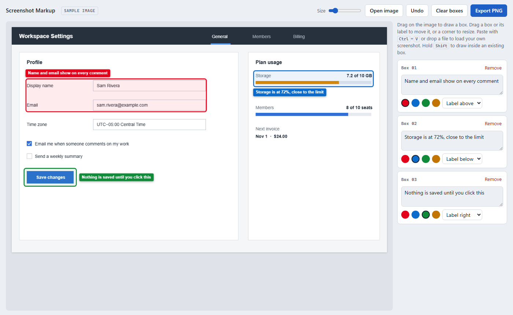
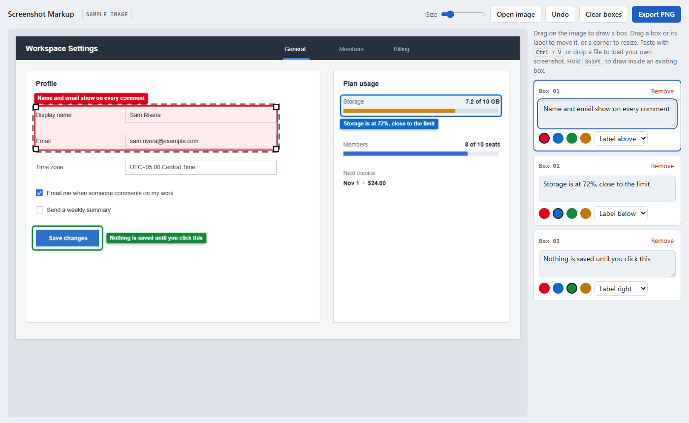
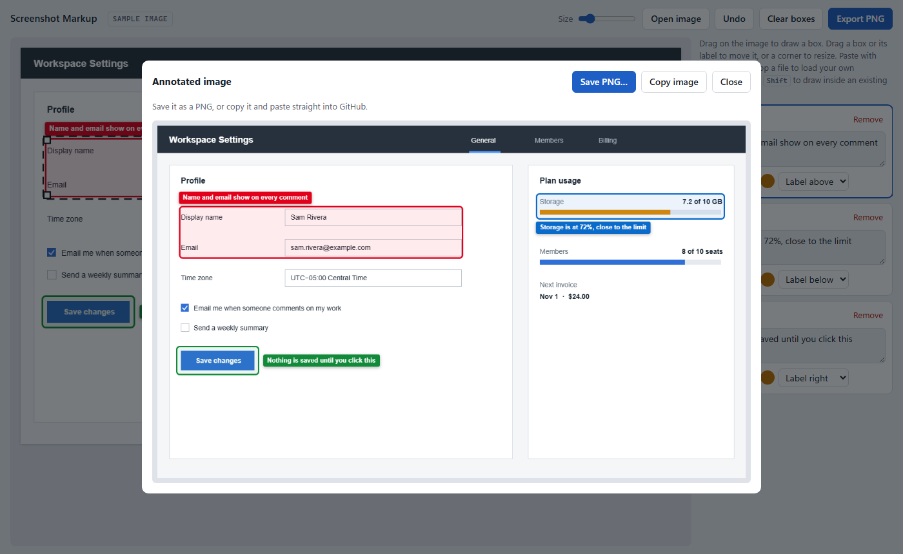
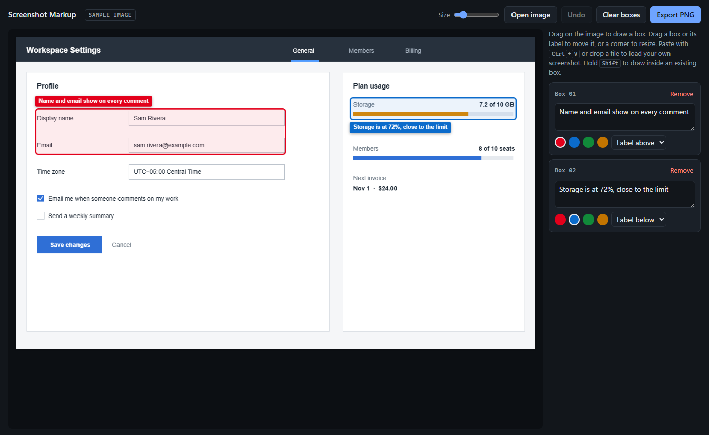

# Screenshot Markup

A small tool for putting boxes and labels on screenshots. I made it because I kept needing annotated screenshots for GitHub issues and PRs, and opening an image editor every time got old.

Paste a screenshot, drag to draw boxes, type a label, export a PNG. That's pretty much it.



## What it does

- Paste a screenshot (Ctrl+V), drag a file in, or open one
- Drag on the image to draw a box, then type a label in the side panel (or leave it blank for a plain box)
- Four colors, and the label can sit above, below, left or right of the box. You can also drag the label anywhere
- Move boxes, resize them from the corners, undo with Ctrl+Z, delete with Delete
- A size slider for high resolution screenshots, so the labels don't end up tiny
- Export to PNG: save it, or copy it and paste straight into a GitHub comment
- Follows your system light/dark mode
- No accounts, nothing uploaded anywhere. Everything stays on your machine

Selecting a box shows its handles, and the label is edited on the right:



Export:



Dark mode:



## Install

### Windows

Grab the latest release from the [Releases page](../../releases):

- `ScreenshotMarkup_1.0.0_x64-setup.exe` installs it and adds it to the Start menu. Use this one if you're not sure.
- `ScreenshotMarkup-portable.exe` is portable, just double-click it. Nothing gets installed.

Works on 64-bit Windows 10 and 11. It uses Microsoft's WebView2, which is already on almost every Windows 10/11 machine. If it isn't, the setup version will install it for you (needs internet the first time), while the portable one just won't open.

Since the exe isn't code-signed, Windows might show "Windows protected your PC" the first time. Click **More info** then **Run anyway**.

### Mac

There's no Mac build yet. The easiest thing is to use the browser version:

1. Download `index.html` from the [Releases page](../../releases) (or from the `dist` folder here)
2. Double-click it. It opens in Safari or Chrome and works offline

Everything works the same. In Chrome you get a normal Save dialog; in Safari the PNG goes to your Downloads folder.

### Linux

Same as Mac, just open `index.html` in Firefox or Chrome.

If you'd rather have a native app, you can build it yourself (see below). You'll need the Tauri system packages first, listed [here](https://v2.tauri.app/start/prerequisites/#linux).

## Building from source

It's a [Tauri 2](https://v2.tauri.app/) app. The whole UI is one file, `dist/index.html`, and `src-tauri/` is just the small Rust wrapper around it.

You need [Node.js](https://nodejs.org/) and [Rust](https://rustup.rs/). Then:

```
npm install
npm run build
```

The exe and installer end up in `src-tauri/target/release/`. On a Mac this gives you a `.app` and `.dmg` instead.

If you only want to change the UI, just edit `dist/index.html` and refresh it in the browser. No build needed.

`make-icon.mjs` generates `app-icon.png`. If you change it, run `npx tauri icon app-icon.png` to regenerate the icons.
